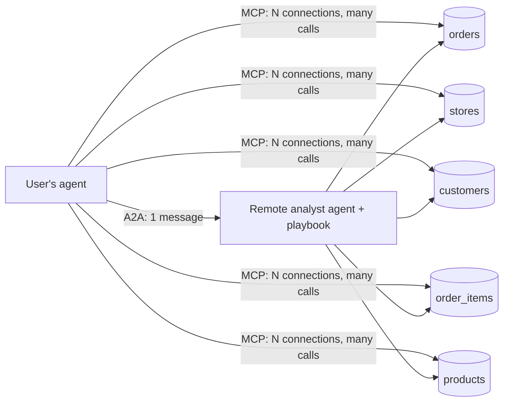
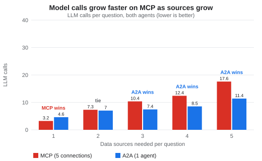
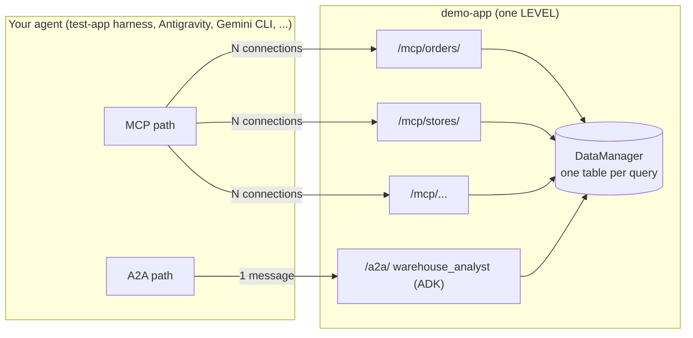

# When to use MCP, and when to use A2A — a measured demo

[](https://github.com/msampathkumar/a2a-mcp-warehouse-demo/actions/workflows/ci.yml)
[](https://github.com/msampathkumar/a2a-mcp-warehouse-demo/releases)
[](LICENSE)

**The question:** your agent needs answers from data spread across several systems. Should it connect to each one over MCP, or ask one A2A agent that handles them for you?

**The short answer:**

- **MCP** fits simple, linear requests: one source, one lookup.
- **An A2A agent** fits questions that combine several sources. Someone has to fetch and join the data; in our test, an agent next to the data did it with fewer calls, fewer tokens on your side, and better accuracy.

**How we know:** 5 data tables, each in a different "place". Path 1: 5 MCP connections, one per table. Path 2: 1 A2A agent (Google ADK) connected to the same 5 tables. Both can read only one table per query. We grew from 1 table to 5 and ran 50 questions × 5 trials through each path: 250 runs per path, 500 in all, every call traced.

**What we're building:**



- **MCP path:** your agent connects to one MCP server per table and joins the data itself.
- **A2A path:** your agent sends one question to a remote agent that reaches every table, joins, and returns the answer.

Read the story: [**blog post**](docs/blog.md) · method and limitations: [report](docs/report.md) · [charts](docs/charts/) · [statistics](docs/results/stats.md)

## Results at a glance

| | MCP (5 connections) | A2A (1 agent) |
| :--- | ---: | ---: |
| Correct answers | 93.6% | 98.4% |
| Calls your agent made | 8,077 | 250 |
| Calls that reached the data sources | 8,077 | 1,079 |
| Tokens in your agent | 6.05M | 0.12M |
| Tokens in total | 6.05M | 3.22M |

- **One source:** both paths are accurate; MCP is the simplest fit.
- **Several sources:** your agent makes 44–79 MCP calls per question, or sends 1 A2A message.
- **Knowledge matters:** the A2A agent loads a [playbook](demo-app/warehouse/playbook.md) (OKRs, rules, workflows, data dictionary). That cut its source calls about 6× and its tokens 56%.

### Model calls grow faster on MCP as sources grow



| Sources needed | LLM calls per question (MCP / A2A) | Takeaway |
| :---: | :---: | :--- |
| 1 | 3.2 / 4.6 | **MCP wins.** Nothing to combine; a second agent adds overhead. |
| 2 | 7.3 / 7.0 | **Tie.** The crossover point. |
| 3 | 10.4 / 7.4 | **A2A wins.** Your agent hands off; the remote agent does the combining. |
| 4 | 12.4 / 8.5 | **A2A wins.** |
| 5 | 17.6 / 11.4 | **A2A wins.** MCP needs ~1.5× the model calls. |

LLM calls count both agents on the A2A path (your agent + the remote agent). Means over 5 trials; the 5-source row is one question.


Have you used both? Tell us what worked for you and what your use case is: open an issue.

## How it works



## Rules both paths share

- Read-only. One table per query (no JOIN/CTE/UNION) — enforced by `sqlglot` and by a locked, read-only DuckDB.
- 500 rows per page. 100 ms simulated distance per source call.
- Same model (`gemini-3.5-flash-lite`, temperature 0) for the client agents and the remote agent.
- Same helper tools to combine data: `save_result`, `list_workspace`, `local_sql` (client-side for MCP, inside the agent for A2A).
- Deliberate differences on the A2A side: a loaded playbook with a data dictionary (`A2A_PLAYBOOK_ENABLED`), a batch-fetch tool (`semi_join_fetch`), and notes (`A2A_NOTES_ENABLED`). An MCP server can only describe its tools; an agent can carry knowledge.
- Caching on both sides, configurable (`CACHE_ENABLED`, `CACHE_TTL_MIN`).

## Levels

| Level | Tables | Columns | Rows | Questions |
| :---: | :--- | ---: | ---: | :---: |
| 1 | orders | 7 | 66,375 | 10 |
| 2 | + stores | 4 | 6 | 10 |
| 3 | + customers | 2 | 2,583 | 10 |
| 4 | + order_items | 3 | 99,753 | 10 |
| 5 | + products | 5 | 10 | 10 |

Data: synthetic, from [jafgen](https://github.com/dbt-labs/jaffle-shop-generator) (Apache-2.0). See [`NOTICE`](NOTICE) and [`demo-app/data/README.md`](demo-app/data/README.md).

## Quick start

Prerequisites: Python 3.12, [`uv`](https://docs.astral.sh/uv/), a Google Cloud project with Vertex AI.

```bash
make install
cp .env.example .env          # set GOOGLE_CLOUD_PROJECT
gcloud auth application-default login
make test                     # 52 tests, no LLM calls
make serve LEVEL=1            # http://localhost:8001
make run LEVEL=1 TRIALS=1     # in another terminal; writes docs/results/<batch>.md
test-app/sweep_parallel.sh v2 5   # all levels x 5 trials in parallel
cd test-app && python -m harness.summary v2 && python -m harness.charts v2
```

Open <http://localhost:8001> for the challenge page and the AI Catalog (`/catalog.json`).

## Repository layout

| Path | What |
| :--- | :--- |
| `demo-app/` | FastAPI app: homepage, AI Catalog, N MCP servers, the A2A agent, DataManager, OpenTelemetry |
| `test-app/` | Harness: client agents, question set + answer key, scoring, report |
| `docs/` | [Report](docs/report.md), [blog draft](docs/blog.md), [per-level results](docs/results/summary.md), [Questions List](docs/questions.md) |
| `deploy/` | Cloud Run notes (TODO) |

## Telemetry

- Every request carries W3C `traceparent` + `baggage` (`run_id`, `q_id`, `trial`, `path`). One trace covers harness → client LLM → MCP/A2A → ADK agent → DataManager.
- Spans: `demo-app/runs/level<N>_spans.jsonl`, `test-app/runs/<batch>/client_spans.jsonl`. Set `OTEL_EXPORTER_OTLP_ENDPOINT` to also send them to a collector (e.g. local Jaeger).
- Counts come from server-side events (`/_stats`), never from what an agent says it did.

## License

Apache-2.0. Not affiliated with dbt Labs.
