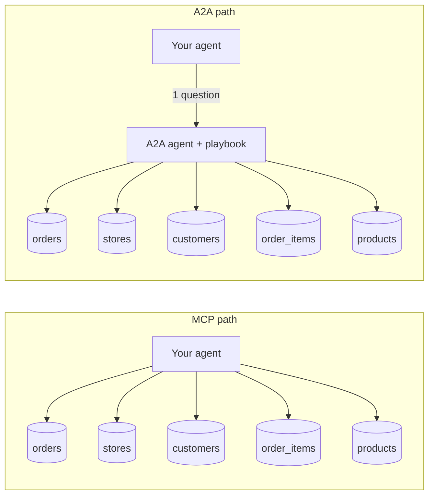
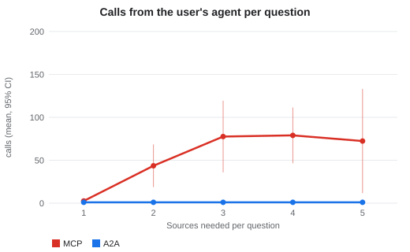
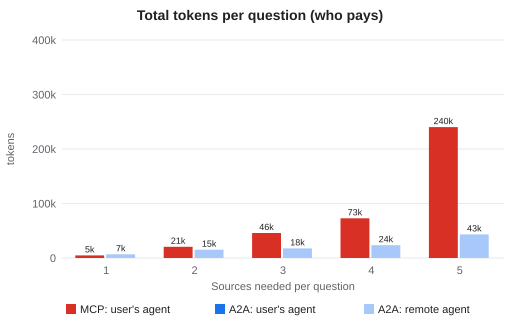
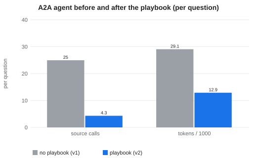

# When to use MCP, and when to use A2A: lessons from 500 measured runs

**Draft — not published.** Full method and numbers: [`report.md`](report.md) · charts: [`charts/`](charts/) · statistics: [`results/stats.md`](results/stats.md)

## The short answer

- **Use MCP** when the data is straightforward and the requests are linear: one source, one lookup, one query. It is the simplest thing that works.
- **Use an A2A agent** when an answer needs data from several sources. As sources multiply, someone has to fetch, combine and reason over the data. In our test, an agent next to the data did it with fewer calls, fewer tokens on your side, and better accuracy than your own agent stitching together many MCP calls.

We didn't want to just assert this, so we measured it.

## What we tested

A sandwich-shop data warehouse with **five tables, each in a different "place"**. Two ways to ask it questions:

- **5 MCP connections**, one per table. Your agent queries each one and combines the results itself.
- **1 A2A agent** (built with Google's Agent Development Kit, ADK) that connects to the same five tables behind the scenes. Your agent sends one question and gets one answer.



The rules were the same on both sides:

- Every query can read **only one table at a time**: no joins at the source, for MCP or for A2A.
- Same model (`gemini-3.5-flash-lite`), same row limits, same simulated network delay per source.
- Both sides can cache, and both get the same tools to combine data locally.

We started with **one table** and added one table per level until all **five** were in play. At each level we asked **10 questions**, from simple counts up to five-table questions.

**In total: 50 questions × 5 trials = 250 runs through MCP and 250 through A2A, 500 in all.** Every call was traced with OpenTelemetry and counted on the server.

## What we found

| | MCP (5 connections) | A2A (1 agent) |
| :--- | ---: | ---: |
| Correct answers | 93.6% | 98.4% |
| Calls your agent made | 8,077 | 250 |
| Calls that reached the data sources | 8,077 | 1,079 |
| Tokens in your agent | 6.05M | 0.12M |
| Tokens in total (both agents) | 6.05M | 3.22M |

**With one source, MCP is the simplest fit.** Both paths were accurate (100% vs 99%). There is nothing to combine, so a second agent adds little.

**With several sources, the work has to happen somewhere.** Once questions needed two or more tables, your agent averaged 44–79 MCP calls and 21k–240k tokens per question (240k is the single five-source question). Through A2A it sent one message and carried about 500 tokens.



**A2A was more predictable.** Your agent makes one call, by design. And 90% of A2A answers finished within 17 seconds at every source count, while MCP's 90th percentile reached 52 seconds.

**MCP's misses clustered in the hardest levels.** 10 of its 16 misses ran out of the 25-step model budget. A2A had 4 misses, including 1 in 5 trials on the five-source question (80% vs MCP's 100% there).



## Why the A2A agent did better: it carries knowledge

An MCP server exposes tools (and can ship prompts and resources, unused here). An A2A agent can act on a whole **playbook** itself. Ours ([`playbook.md`](../demo-app/warehouse/playbook.md)) holds:

- objectives and key results ("right answer, fewest source calls"),
- rules (group by id, not name; money is in cents),
- step-by-step workflows for common question types,
- a data dictionary, with the small reference tables preloaded,
- a helper tool that fetches matching rows in batches.

In an earlier run without the playbook (1 trial), A2A only moved the cost from your agent to the remote one. With the playbook, the remote agent hit the data sources **about 6× less often** and used **56% fewer tokens**. Total tokens came in 47% below MCP. The gain came from the playbook, not the protocol: A2A is what lets that playbook live with the data.



## What we think this means (opinion, not measured)

**Data owners don't share everything.** Many data owners won't publish how their data is laid out, how long it stays valid, or the tricks for querying it well. With MCP, that knowledge has to reach every consumer. With A2A, it stays inside the agent's instructions, and consumers just ask questions.

**MCP-only setups need more pieces.** To make raw MCP access usable, a data owner typically ships three things: the MCP servers, documentation, and an `AGENTS.md`-style guide for each client agent. An A2A agent can package all three behind one endpoint.

**Teams ask overlapping questions.** We used one agent and one user. In a team, many people ask about the same data, and a shared A2A agent can reuse its cache and notes across them. We didn't measure that here; it's the next experiment.

## Both have trade-offs

| | MCP | A2A agent |
| :--- | :--- | :--- |
| Best for | Simple, linear requests on one source | Questions that combine several sources |
| Your agent's work | Fetches and combines everything | Sends one question |
| Where cost lands | Your agent | The data owner's agent |
| Knowledge sharing | Tool descriptions, plus docs you ship separately | Built into the agent's instructions |
| Moving parts | Fewer (no second agent) | A second agent to build and run |

They also work together: an A2A agent can use MCP tools internally. Here we kept them separate only to measure each one cleanly.

## Caveats

One model, synthetic data, local runs with simulated latency. Runs executed in parallel, so compare the two paths, not the absolute seconds. The A2A side had more help by design: the playbook, a batch-fetch tool, notes, and its own model budget. A richer MCP client prompt would narrow the gap. Only 3 questions need four sources and 1 needs five, so those results are noisy.

## Try it, and tell us

```bash
make install && make serve LEVEL=3
```

Point your own coding agent at `http://localhost:8003/catalog.json`, through MCP or A2A, and compare.

**If you've used both, we'd like to hear from you:** what worked better for you, and what is your use case or problem statement?
