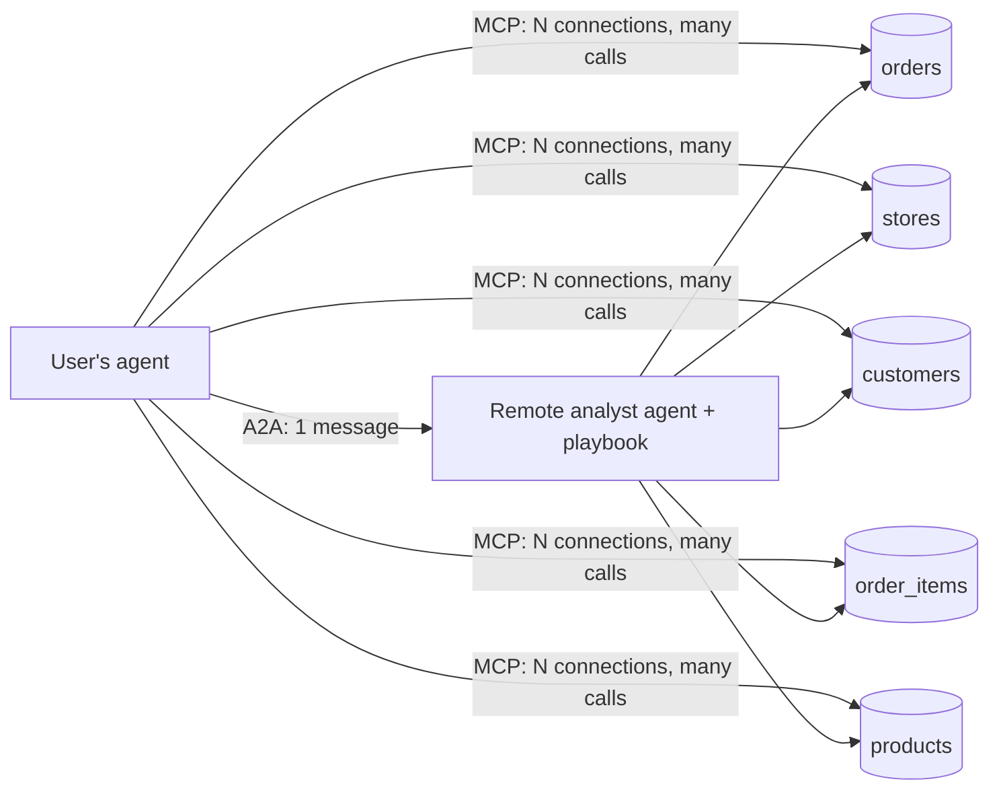
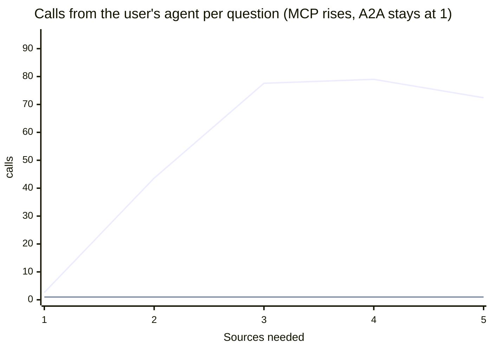

# Experiment report: MCP and A2A over a distributed data warehouse

**Date:** 2026-10-13 · **Main sweep (v2):** 5 levels × 10 questions × 2 paths × 5 trials = 500 attempts · **Model:** `gemini-3.5-flash-lite`, temperature 0, on every agent

Every number is re-derived from raw event files under [`results/`](results/). Tables: [`results/summary.md`](results/summary.md) (v2) and [`results/summary-v1.md`](results/summary-v1.md) (v1: 1 trial, no playbook).

## Question

Five tables live in five "places". Each place answers only single-table queries. Who should combine the data?

- **MCP path:** the user's agent connects to one MCP server per table and joins the data itself.
- **A2A path:** the user's agent sends the question to one remote agent (Google ADK) that reaches every table, joins, and returns the answer.



## Setup

| | MCP path | A2A path |
| :--- | :--- | :--- |
| Who joins | User's agent | Remote agent |
| Join helpers | `save_result`, `local_sql` | Same, plus `semi_join_fetch` |
| Instructions | Tool descriptions only | **Playbook** ([`playbook.md`](../demo-app/warehouse/playbook.md)): OKRs, rules, 5 workflows, tips, tools table, plus a live data dictionary with the small tables preloaded |
| Notes | — | `read_notes` / `write_notes` |
| Cache | Client-side, 60 min | Server-side, 60 min |
| LLM cap per question | 25 | 25 (user's agent) + 25 (remote) |

The playbook is the point of v2: an MCP server can only describe its tools, while an A2A agent can carry domain knowledge, workflows and data with it.

Shared rules: read-only, one table per query (validated with `sqlglot`, enforced by a locked read-only DuckDB), 500 rows per page, 100 ms simulated distance per source call, 20,000-row cap per saved result. Data: synthetic jafgen output (Apache-2.0).

## Results (v2, 500 attempts)

| Metric | MCP path | A2A path | Change |
| :--- | ---: | ---: | ---: |
| Correct | 234/250 (93.6%) | 246/250 (98.4%) | +4.8 pts |
| Calls from the user's agent | 8,077 | 250 | −97% |
| DataManager calls | 8,077 | 1,079 | −87% |
| End-to-end time* | 3,882 s | 1,901 s | −51% |
| LLM calls (user's agent + remote) | 1,599 | 500 + 1,044 = 1,544 | −3% |
| Tokens in the user's agent | 6,054,679 | 122,563 | −98% |
| Tokens in total | 6,054,679 | 3,217,972 | −47% |

\*All 25 runs ran in parallel on one machine, so absolute times are inflated. Compare the paths, not the seconds.

### By number of sources a question needs

| Sources | Questions | Correct MCP / A2A | Calls from user's agent MCP / A2A | DataManager calls MCP / A2A | Seconds MCP / A2A | User's-agent tokens MCP / A2A |
| :---: | ---: | :---: | :---: | :---: | :---: | :---: |
| 1 | 22 | 100% / 99% | 2.6 / 1.0 | 2.6 / 2.0 | 10.1 / 5.9 | 4,820 / 463 |
| 2 | 18 | 92% / 98% | 43.6 / 1.0 | 43.6 / 7.3 | 17.5 / 8.8 | 20,573 / 487 |
| 3 | 6 | 77% / 100% | 77.6 / 1.0 | 77.6 / 4.5 | 21.1 / 8.5 | 45,960 / 545 |
| 4 | 3 | 87% / 100% | 79.0 / 1.0 | 79.0 / 3.2 | 28.3 / 9.4 | 72,899 / 552 |
| 5 | 1 | 100% / 80% | 72.4 / 1.0 | 72.4 / 3.2 | 28.6 / 12.9 | 240,122 / 629 |

Means per attempt over 5 trials. "Calls from the user's agent" = MCP tool calls that reached a server (cache hits excluded) or A2A messages sent.



### The playbook's effect (A2A path, v1 → v2)

| A2A metric, all 50 questions | v1: no playbook (1 trial) | v2: playbook (5 trials) |
| :--- | ---: | ---: |
| DataManager calls per question | 25.0 | 4.3 |
| Total tokens per question | 29,053 | 12,872 |
| Correct | 100% (50/50, 2 re-scored) | 98.4% |

With the playbook, the remote agent hit the sources about 6× less often and used 56% fewer tokens. Total A2A tokens went from 47% *more* than MCP (v1) to 47% *fewer* (v2).

## Findings

1. **Single-source questions: both work; MCP is the simplest fit.** Accuracy 100% (MCP) vs 99% (A2A). With one source there is nothing to combine.
2. **Multi-source questions: A2A fits better.** On MCP the user's agent made 44–79 calls per question; on A2A, 1. Its tokens were 20k–240k vs about 500.
3. **Instructions are what make delegation pay off.** Without a playbook (v1), A2A moved the cost to the remote agent but did not reduce it. With one (v2), source calls fell 87% and total tokens 47% versus MCP. Only the agent side can carry a playbook like this.
4. **MCP misses clustered in the hardest levels.** 16 MCP misses: 10 hit the 25-LLM-call cap, 5 were wrong answers, and 1 was a model-API rate-limit error (429), all but one at levels 4–5. A2A had 4 misses (one an empty reply), and its remote agent never hit its cap.

## Limitations

- **The A2A agent had more help:** a playbook, a data dictionary with the small tables preloaded, `semi_join_fetch`, notes, and a second LLM budget. That asymmetry is the thesis (an agent can carry knowledge; an MCP server can't), but a richer MCP client prompt would narrow the gap.
- **Parallel runs** inflate absolute times, and caused one model-API rate-limit error (429) on the MCP path, counted as a miss.
- **Small groups:** 3 questions need 4 sources, 1 needs 5. Rates on those rows are noisy.
- **Local, synthetic, one model.** The 100 ms per-source latency is simulated.
- **v1 history:** the first v1 level-2/3 runs were discarded after a paging-bug fix, and 2 v1 A2A answers were re-scored after a parser fix (listed in their batch reports). v2 had no re-scored attempts.

## Reproduce

```bash
make install && cp .env.example .env   # set GOOGLE_CLOUD_PROJECT
make tally
test-app/sweep_parallel.sh v2 5
cd test-app && python -m harness.summary v2
```
