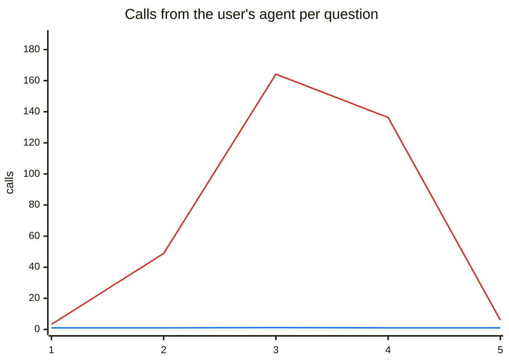
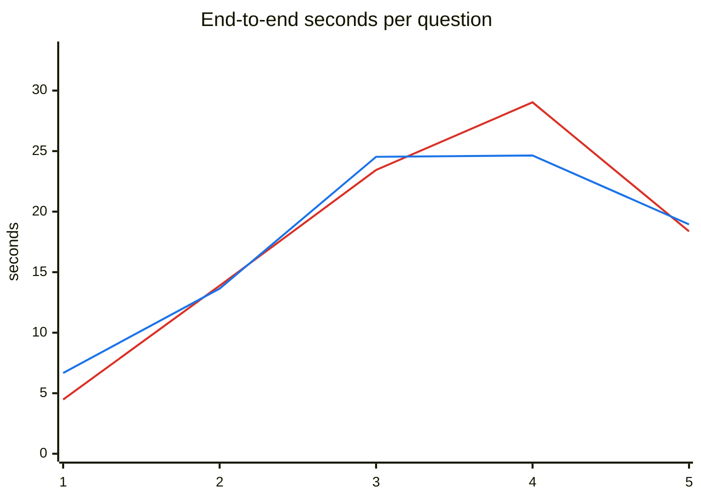
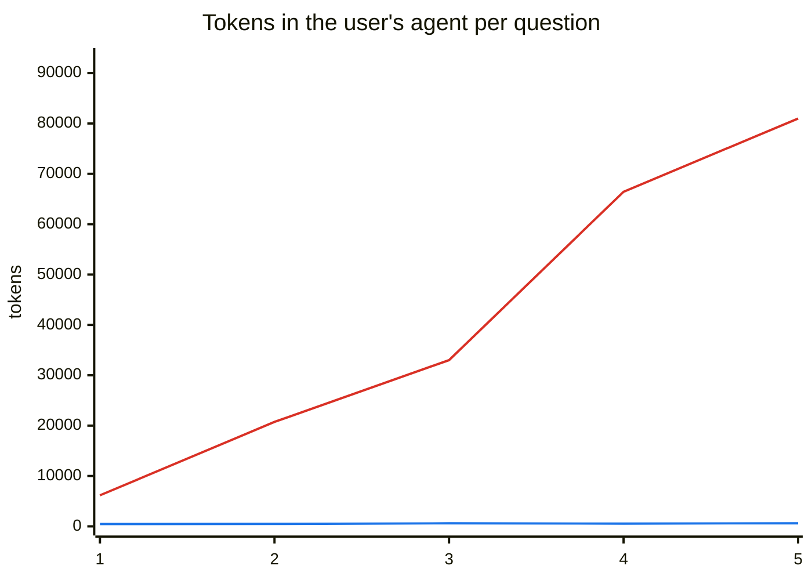

# Summary — sweep v1 (1 trial, no playbook)

Sweep: `newest batch per level`. Batches used:

- Level 1 (1 trial(s)): [`20261013-190612-L1-db7f`](20261013-190612-L1-db7f.md)
- Level 2 (1 trial(s)): [`20261013-194029-L2-d45c`](20261013-194029-L2-d45c.md)
- Level 3 (1 trial(s)): [`20261013-194326-L3-5c0d`](20261013-194326-L3-5c0d.md)
- Level 4 (1 trial(s)): [`20261013-194550-L4-8e6b`](20261013-194550-L4-8e6b.md)
- Level 5 (1 trial(s)): [`20261013-195307-L5-10d2`](20261013-195307-L5-10d2.md)

Values are means per question attempt. Calls from the user's agent = MCP tool calls that reached a server (cache hits excluded) or A2A messages sent.

## By number of sources a question needs

| Sources | Questions | Correct MCP | Correct A2A | Calls from user's agent (MCP) | Calls from user's agent (A2A) | DataManager calls (MCP) | DataManager calls (A2A) | End-to-end s (MCP) | End-to-end s (A2A) | Tokens: user's agent (MCP) | Tokens: user's agent (A2A) | Tokens: total (A2A) |
|---|---:|---:|---:|---:|---:|---:|---:|---:|---:|---:|---:|---:|
| 1 | 22 | 100% | 100% | 3.2 | 1.0 | 3.2 | 3.5 | 4.5 | 6.7 | 6,158 | 462 | 4,341 |
| 2 | 18 | 83% | 100% | 48.9 | 1.0 | 48.9 | 33.9 | 13.9 | 13.6 | 20,735 | 480 | 16,151 |
| 3 | 6 | 100% | 100% | 164.2 | 1.2 | 164.2 | 80.7 | 23.4 | 24.5 | 33,006 | 601 | 61,146 |
| 4 | 3 | 67% | 100% | 136.3 | 1.0 | 136.3 | 22.0 | 29.0 | 24.6 | 66,440 | 551 | 147,875 |
| 5 | 1 | 100% | 100% | 6.0 | 1.0 | 6.0 | 12.0 | 18.4 | 19.0 | 80,985 | 615 | 255,948 |

## By level

| Level | Questions | Correct MCP | Correct A2A | Calls from user's agent (MCP) | Calls from user's agent (A2A) | DataManager calls (MCP) | DataManager calls (A2A) | End-to-end s (MCP) | End-to-end s (A2A) | Tokens: user's agent (MCP) | Tokens: user's agent (A2A) | Tokens: total (A2A) |
|---|---:|---:|---:|---:|---:|---:|---:|---:|---:|---:|---:|---:|
| 1 | 10 | 100% | 100% | 1.1 | 1.0 | 1.1 | 1.1 | 4.2 | 6.1 | 3,063 | 472 | 4,357 |
| 2 | 10 | 90% | 100% | 7.2 | 1.0 | 7.2 | 11.0 | 7.0 | 10.0 | 12,237 | 467 | 14,767 |
| 3 | 10 | 100% | 100% | 4.4 | 1.0 | 4.4 | 8.9 | 5.1 | 8.4 | 6,336 | 464 | 7,976 |
| 4 | 10 | 80% | 100% | 142.8 | 1.0 | 142.8 | 68.6 | 25.5 | 17.3 | 42,093 | 520 | 20,607 |
| 5 | 10 | 90% | 100% | 79.6 | 1.1 | 79.6 | 35.2 | 17.6 | 21.4 | 34,976 | 545 | 97,559 |

## Charts (by sources needed)

Red line: MCP path · Blue line: A2A path.

Red line: MCP path · Blue line: A2A path.

Red line: MCP path · Blue line: A2A path.

