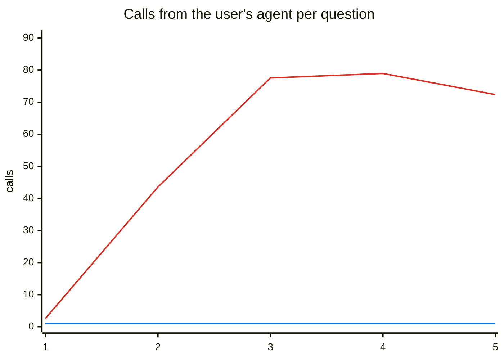
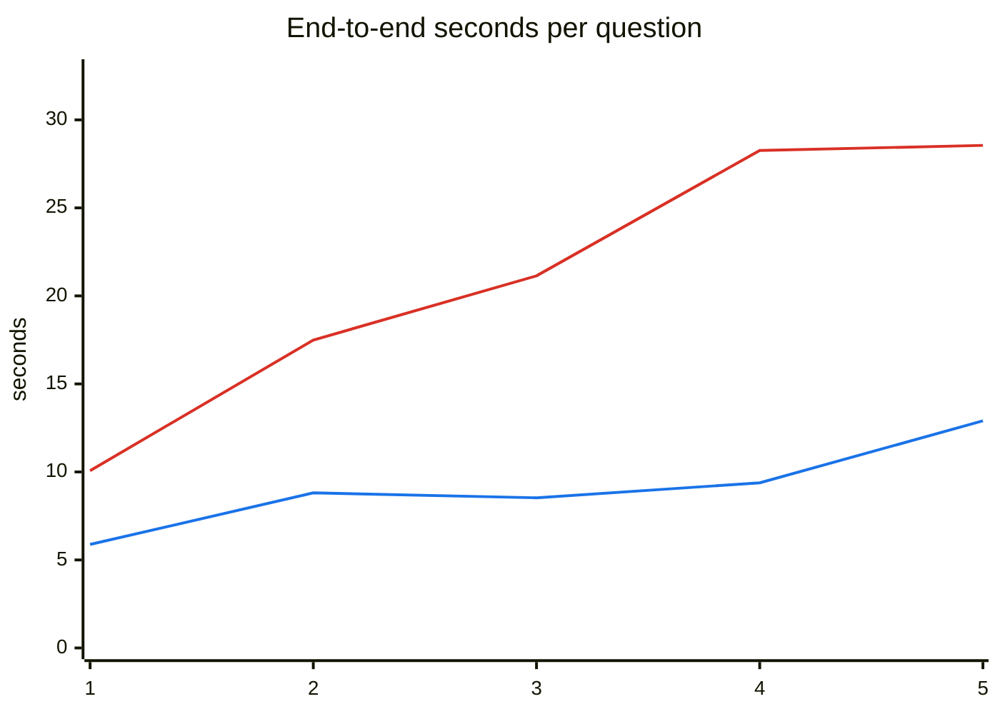
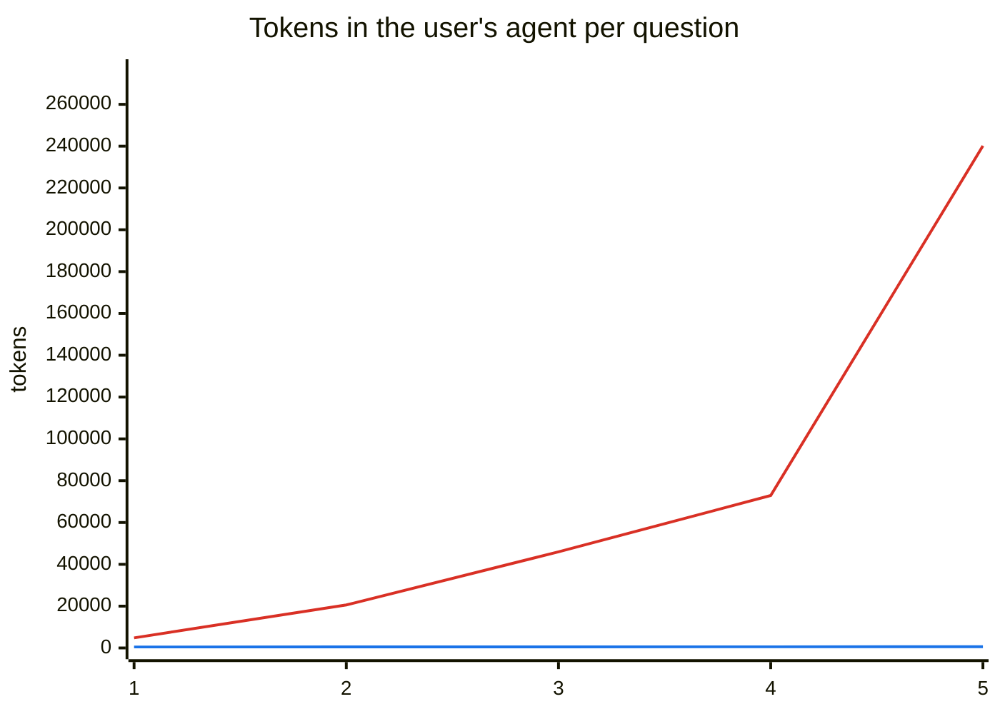

# Summary — sweep v2 (5 trials, A2A playbook on)

Sweep: `v2`. Batches used:

- Level 1 (5 trial(s)): [`20261013-211849-L1-v2-1a54`](20261013-211849-L1-v2-1a54.md), [`20261013-211853-L1-v2-56f4`](20261013-211853-L1-v2-56f4.md), [`20261013-211855-L1-v2-182e`](20261013-211855-L1-v2-182e.md), [`20261013-211855-L1-v2-fbad`](20261013-211855-L1-v2-fbad.md), [`20261013-211857-L1-v2-d174`](20261013-211857-L1-v2-d174.md)
- Level 2 (5 trial(s)): [`20261013-211845-L2-v2-a5a1`](20261013-211845-L2-v2-a5a1.md), [`20261013-211852-L2-v2-9d60`](20261013-211852-L2-v2-9d60.md), [`20261013-211856-L2-v2-d141`](20261013-211856-L2-v2-d141.md), [`20261013-211857-L2-v2-2235`](20261013-211857-L2-v2-2235.md), [`20261013-211901-L2-v2-ecfe`](20261013-211901-L2-v2-ecfe.md)
- Level 3 (5 trial(s)): [`20261013-211851-L3-v2-2b52`](20261013-211851-L3-v2-2b52.md), [`20261013-211852-L3-v2-5ea9`](20261013-211852-L3-v2-5ea9.md), [`20261013-211900-L3-v2-180c`](20261013-211900-L3-v2-180c.md), [`20261013-211900-L3-v2-9597`](20261013-211900-L3-v2-9597.md), [`20261013-211903-L3-v2-302e`](20261013-211903-L3-v2-302e.md)
- Level 4 (5 trial(s)): [`20261013-211845-L4-v2-f528`](20261013-211845-L4-v2-f528.md), [`20261013-211855-L4-v2-9acf`](20261013-211855-L4-v2-9acf.md), [`20261013-211900-L4-v2-21f2`](20261013-211900-L4-v2-21f2.md), [`20261013-211901-L4-v2-23f6`](20261013-211901-L4-v2-23f6.md), [`20261013-211902-L4-v2-9117`](20261013-211902-L4-v2-9117.md)
- Level 5 (5 trial(s)): [`20261013-211849-L5-v2-6b06`](20261013-211849-L5-v2-6b06.md), [`20261013-211850-L5-v2-1245`](20261013-211850-L5-v2-1245.md), [`20261013-211850-L5-v2-b8ae`](20261013-211850-L5-v2-b8ae.md), [`20261013-211855-L5-v2-ef79`](20261013-211855-L5-v2-ef79.md), [`20261013-211900-L5-v2-413c`](20261013-211900-L5-v2-413c.md)

Values are means per question attempt. Calls from the user's agent = MCP tool calls that reached a server (cache hits excluded) or A2A messages sent.

## By number of sources a question needs

| Sources | Questions | Correct MCP | Correct A2A | Calls from user's agent (MCP) | Calls from user's agent (A2A) | DataManager calls (MCP) | DataManager calls (A2A) | End-to-end s (MCP) | End-to-end s (A2A) | Tokens: user's agent (MCP) | Tokens: user's agent (A2A) | Tokens: total (A2A) |
|---|---:|---:|---:|---:|---:|---:|---:|---:|---:|---:|---:|---:|
| 1 | 22 | 100% | 99% | 2.6 | 1.0 | 2.6 | 2.0 | 10.1 | 5.9 | 4,820 | 463 | 6,730 |
| 2 | 18 | 92% | 98% | 43.6 | 1.0 | 43.6 | 7.3 | 17.5 | 8.8 | 20,573 | 487 | 15,301 |
| 3 | 6 | 77% | 100% | 77.6 | 1.0 | 77.6 | 4.5 | 21.1 | 8.5 | 45,960 | 545 | 17,685 |
| 4 | 3 | 87% | 100% | 79.0 | 1.0 | 79.0 | 3.2 | 28.3 | 9.4 | 72,899 | 552 | 23,551 |
| 5 | 1 | 100% | 80% | 72.4 | 1.0 | 72.4 | 3.2 | 28.6 | 12.9 | 240,122 | 629 | 43,358 |

## By level

| Level | Questions | Correct MCP | Correct A2A | Calls from user's agent (MCP) | Calls from user's agent (A2A) | DataManager calls (MCP) | DataManager calls (A2A) | End-to-end s (MCP) | End-to-end s (A2A) | Tokens: user's agent (MCP) | Tokens: user's agent (A2A) | Tokens: total (A2A) |
|---|---:|---:|---:|---:|---:|---:|---:|---:|---:|---:|---:|---:|
| 1 | 10 | 100% | 100% | 1.1 | 1.0 | 1.1 | 1.0 | 8.0 | 5.8 | 3,080 | 473 | 5,672 |
| 2 | 10 | 98% | 98% | 9.0 | 1.0 | 9.0 | 10.5 | 11.1 | 9.3 | 11,302 | 472 | 14,432 |
| 3 | 10 | 100% | 100% | 4.3 | 1.0 | 4.3 | 2.9 | 9.3 | 7.0 | 7,212 | 471 | 10,430 |
| 4 | 10 | 78% | 98% | 87.7 | 1.0 | 87.7 | 4.9 | 26.3 | 7.8 | 43,546 | 522 | 14,721 |
| 5 | 10 | 92% | 96% | 59.5 | 1.0 | 59.5 | 2.3 | 23.0 | 8.1 | 55,954 | 513 | 19,104 |

## Charts (by sources needed)

Red line: MCP path · Blue line: A2A path.

Red line: MCP path · Blue line: A2A path.

Red line: MCP path · Blue line: A2A path.

